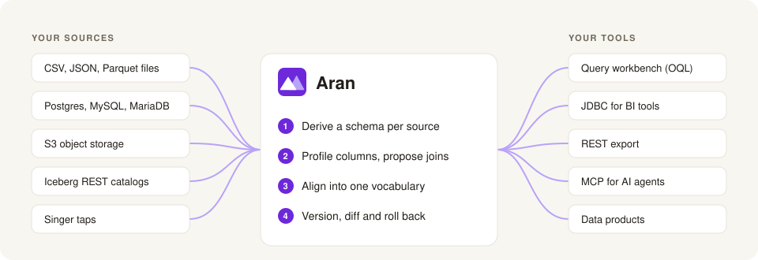
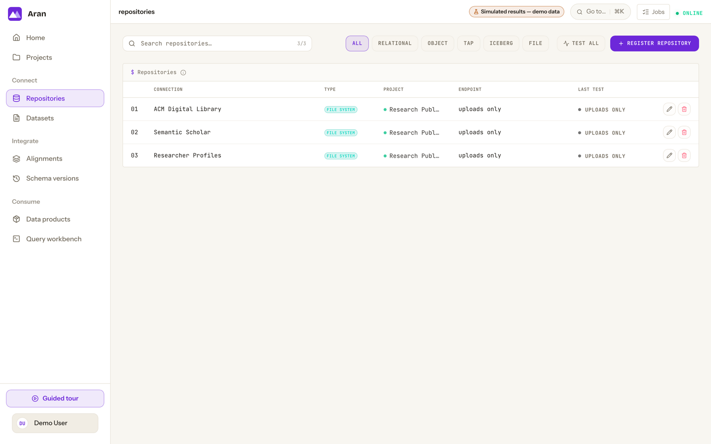
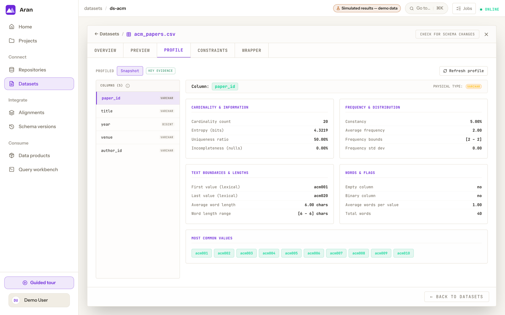
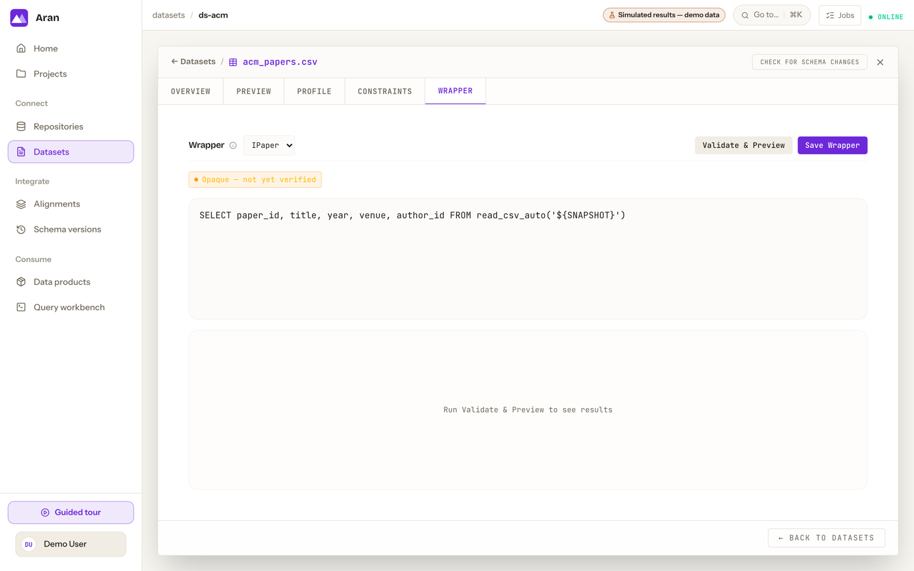
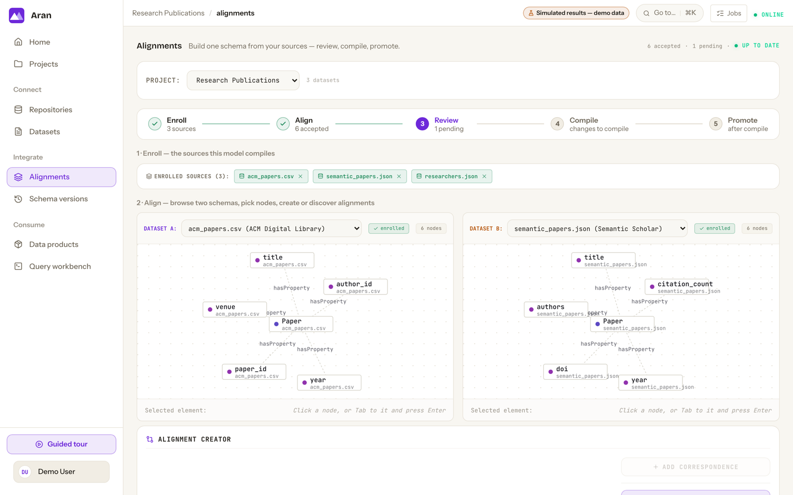
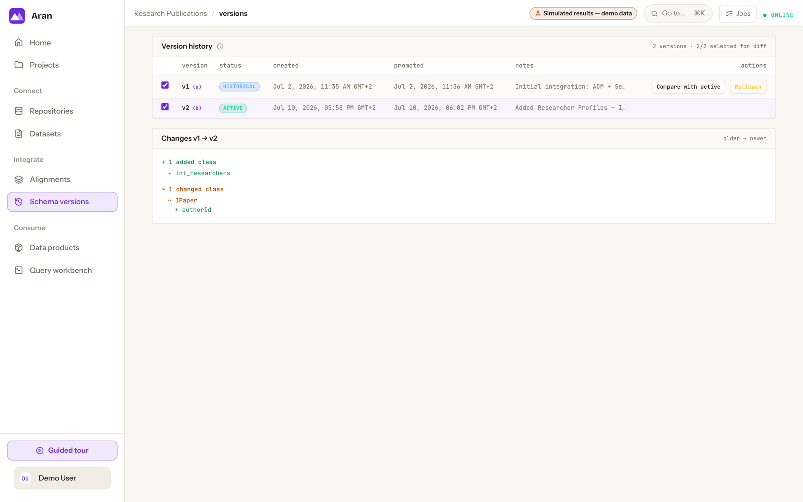
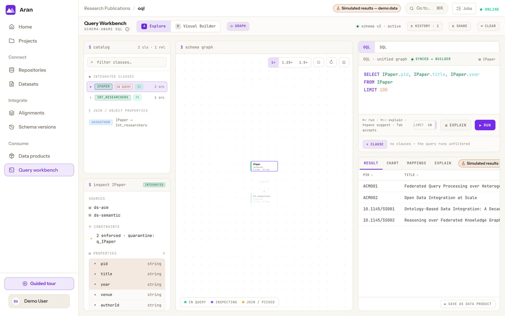
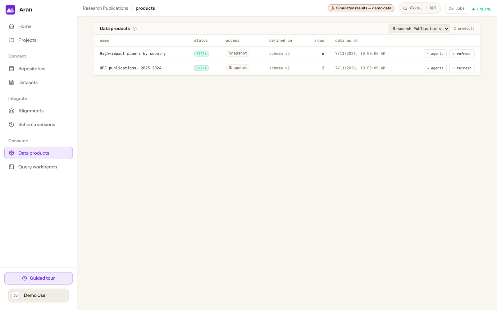
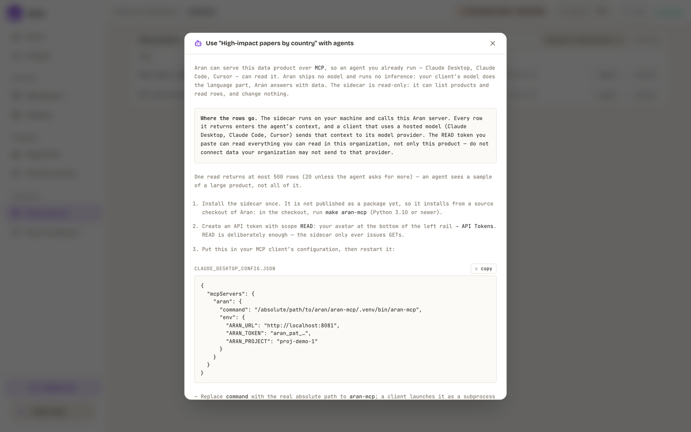

<h1>
  <picture>
    <source media="(prefers-color-scheme: dark)" srcset="docs-site/static/img/aran-lockup-dark.svg">
    
  </picture>
</h1>

**Your data sources were never designed to fit together. Aran integrates them anyway.**

[](LICENSE)


<p align="center">
  
</p>

Aran is a data integration platform for organisations with many dissimilar data
sources. You register your sources. Aran derives a schema for each one from the data,
proposes joins from profiling evidence, and helps you align the schemas into one
shared, versioned vocabulary. You can then query all the sources together, even when
they differ in format, storage engine and column names.

Queries are written in OQL against the integrated vocabulary. The engine plans them
with Apache Calcite and runs them on DuckDB, either over snapshots in the platform's
own lake or, for PostgreSQL, MySQL and MariaDB sources marked as federated, against
the live database.

Aran stores the integration as a graph, which you can query, compare between
versions and constrain, and compiles it into SQL. Results are available over JDBC
(Aran appears as a database), a REST export, and MCP for AI agents. Aran runs as one
self-hosted Docker Compose stack.

**Documentation:** [Overview](docs-site/docs/index.md) ·
[What is Aran](docs-site/docs/overview/what-is-aran.md) ·
[Why Aran](docs-site/docs/overview/why-aran.md) ·
[Core concepts](docs-site/docs/overview/core-concepts.md) ·
[Quickstart](docs-site/docs/getting-started/quickstart.md) ·
[Walkthrough](docs-site/docs/getting-started/walkthrough.md) ·
[OQL tutorial](docs-site/docs/oql/tutorial.md) ·
[Contributor guide](docs-site/docs/contributing/index.md)

> **Research preview.** Aran is pre-1.0 research software from the [DTAK](https://dtak.upc.edu/en) research
> group at Universitat Politècnica de Catalunya. Run it self-hosted, on a network you
> trust, for users you trust. It is not hardened for untrusted users or for
> multi-tenant hosting on the public internet. Read [Security](#security) before
> deploying it anywhere else.

---

## What it does

1. Register sources: upload CSV, JSON or Parquet files, or connect a PostgreSQL,
   MySQL or MariaDB database, S3-compatible object storage, an Iceberg REST catalog
   or a Singer tap.
2. Aran bootstraps a schema for each source from its data, with an editable SQL
   wrapper that defines how each class is read.
3. Aran profiles the columns and proposes join candidates based on their values.
4. You align classes and properties across sources into one integrated schema,
   compile it, and promote it as a new version. You can compare any two versions and
   roll back.
5. You query the integrated schema in OQL, publish results as data products, and
   read them over JDBC, REST, Iceberg REST or MCP.

## A look around

Screens from the built-in demo, which integrates three sources about research papers.
Click an image to see it full size.

<table>
  <tr>
    <td width="50%" valign="top">
      <a href="docs-site/static/img/screenshots/repositories.png"></a>
      <br><b>Register sources.</b> Each repository is a connection to where data lives: files, databases, object storage, Iceberg catalogs or Singer taps.
    </td>
    <td width="50%" valign="top">
      <a href="docs-site/static/img/screenshots/dataset-profile.png"></a>
      <br><b>Profile every column.</b> Cardinality, distributions and common values, computed from the data. These profiles drive join discovery and query costing.
    </td>
  </tr>
  <tr>
    <td width="50%" valign="top">
      <a href="docs-site/static/img/screenshots/wrapper.png"></a>
      <br><b>See how each source is read.</b> Aran generates a SQL wrapper per source class. You can edit it, validate it and preview its rows.
    </td>
    <td width="50%" valign="top">
      <a href="docs-site/static/img/screenshots/alignments.png"></a>
      <br><b>Align two sources.</b> Browse the schemas derived from a CSV file and a JSON file side by side, and map their classes and properties to shared ones.
    </td>
  </tr>
  <tr>
    <td width="50%" valign="top">
      <a href="docs-site/static/img/screenshots/versions.png"></a>
      <br><b>Version the integration.</b> Every promoted schema is a version. Compare any two and roll back if needed.
    </td>
    <td width="50%" valign="top">
      <a href="docs-site/static/img/screenshots/query-workbench.png"></a>
      <br><b>Query across sources.</b> Write OQL against the integrated schema. One query returns rows from both the CSV and the JSON source.
    </td>
  </tr>
  <tr>
    <td width="50%" valign="top">
      <a href="docs-site/static/img/screenshots/products.png"></a>
      <br><b>Publish data products.</b> Save a query as a product, materialized as a snapshot or computed on every read, and read it over JDBC, REST or Iceberg REST.
    </td>
    <td width="50%" valign="top">
      <a href="docs-site/static/img/screenshots/agents.png"></a>
      <br><b>Hand it to an AI agent.</b> Aran serves products over MCP, so Claude Desktop, Claude Code or Cursor can read them with a read-only token.
    </td>
  </tr>
</table>

## Quickstart

### With Docker only

Requires Docker 24+ with Compose v2.

```bash
docker compose -f compose.standalone.yml up --build
```

Open http://localhost:8080 and sign in as `alice`. The first start prints a one-time
administrator password to the application log:

```bash
docker compose -f compose.standalone.yml logs aran-app | grep -A3 'first-run administrator'
```

Keycloak asks you to change it at first login. To choose the password yourself, set
`ARAN_ADMIN_PASSWORD` before the first start. The full guide is
[Run Aran standalone](docs-site/docs/administration/standalone.md).

### For development

Requires JDK 25, Node.js 20+, Docker 24+ with Compose v2, and Python 3.12.

```bash
make all
```

This starts the whole stack: the lake's Docker dependencies, the `aran-lake` FastAPI
service, the FREYJA profiling sidecar, Postgres, Keycloak, Fuseki, the Spring Boot
backend and the Vite dev server, and then opens the UI. The first run also creates
the lake's Python virtual environment, which takes a few minutes.

| Service | URL |
| --- | --- |
| Web UI | http://localhost:5173 |
| Backend API | http://localhost:8081/api |
| Lake API | http://localhost:8085 |
| FREYJA sidecar | http://localhost:8086 |
| Keycloak | http://localhost:8080 |
| Fuseki | http://localhost:3030 |

The development realm signs you in as `alice` / `aran`. Keycloak's own console uses
`admin` / `admin`. Both are published in this repository and are for local
development only.

`make stop` shuts everything down. The `./aran` CLI wraps the same scripts
(`./aran start|stop|restart|status`).

For a guided, read-only tour that runs entirely in the browser, run
`cd aran-web && npm run dev:demo` and sign in as `demo` / `demo`.
[`demo/seminar/DEMO.md`](demo/seminar/DEMO.md) walks through a full integration over
sample data, and [`demo/seminar/MCP_DEMO.md`](demo/seminar/MCP_DEMO.md) continues it
by connecting an AI agent.

## Getting data in

Uploading a file works for every repository type. Aran can also import a table
from a **PostgreSQL** repository, read PostgreSQL, MySQL and MariaDB tables live
(federated), read or copy objects from **object storage** (`s3://`), read
**Iceberg** tables through a REST catalog, and pull streams from a **Singer tap**
that the operator has configured. There is no connector for document stores, caches
or generic web APIs; export that data to a file and upload it. The
[capability table](docs-site/docs/repositories/index.md) lists what each type
supports.

## What is in this repository

| Path | What it is |
| --- | --- |
| `aran-core` | Domain model, outbound ports and the `Operator` contract. No web, no JPA. |
| `aran-application` | The deployable Spring Boot app: HTTP, security, wiring. |
| `aran-adapters/*` | Persistence (JPA + Flyway), the Iceberg REST client and the signed-token licence provider. |
| `aran-operators/*` | Platform capabilities: bootstrapping, profiling, join discovery, schema integration, constraint discovery, query engine. |
| `aran-lake` | FastAPI service that owns snapshots, imports and materialisation (Python). |
| `freyja` | Profiling and join-discovery sidecar (Python). |
| `aran-client` | The Python SDK. It versions independently and has its own changelog. |
| `aran-mcp` | The MCP sidecar that serves Aran to AI agents (Python). |
| `aran-web` | The web client (React 19 + Vite). |
| `docs-site` | Source for the documentation site (Docusaurus). |
| `demo` | Sample data and demo scenarios. |
| `tests/sidecar_contract` | The security contract every Python sidecar must satisfy. |

Dependencies point one way: `aran-core` ← adapters and operators ← application.
`ArchitectureTest` in aran-application fails the build if the core imports Spring
Web, Spring Data, Spring Security, JPA, Hibernate, servlet or DuckDB types, or any
adapter, operator or application class. See
[Module layout](docs-site/docs/contributing/module-layout.md).

## Building and testing

```bash
make bootstrap                     # once: the Python venvs and node_modules the gate needs
./scripts/validate.sh              # the full gate (needs Docker for Testcontainers)
./scripts/validate.sh --offline    # everything that does not need a Docker daemon
./scripts/validate.sh --java       # one part: --java, --web or --python (combinable)
```

`RUN_PERF=1` adds the query-engine performance benchmark, and `RUN_E2E=1` adds the
browser end-to-end suite (Playwright) to the full gate. See
[CONTRIBUTING.md](CONTRIBUTING.md) and
[Build and test](docs-site/docs/contributing/build-and-test.md).

## Security

Aran is a research preview. Deploy it on a trusted network, for trusted users.

- The development realm and compose files ship **published default credentials**
  (`alice` / `aran`, Keycloak `admin` / `admin`). Never expose a development stack.
- The standalone stack generates the first administrator password and listens only
  on loopback by default. Read
  [Run Aran standalone](docs-site/docs/administration/standalone.md) before making it
  reachable from another machine.
- Multi-tenant hosting for untrusted users is not a supported configuration yet.

Report vulnerabilities privately as described in [SECURITY.md](SECURITY.md). Please
do not open a public issue.

## Project

| | |
| --- | --- |
| **License** | [Apache License 2.0](LICENSE). See [`NOTICE`](NOTICE) for attribution. |
| **Citing** | [`CITATION.cff`](CITATION.cff). GitHub's "Cite this repository" button reads it. |
| **Changes** | [`CHANGELOG.md`](CHANGELOG.md). Aran is pre-1.0, so breaking changes land in minor releases. |
| **Contributing** | [`CONTRIBUTING.md`](CONTRIBUTING.md). Commits are signed off (DCO); there is no CLA. |
| **Conduct** | [`CODE_OF_CONDUCT.md`](CODE_OF_CONDUCT.md) |

Aran is developed by the **[DTAK research group](https://dtak.upc.edu/en)** at
[Universitat Politècnica de Catalunya (UPC)](https://www.upc.edu).
