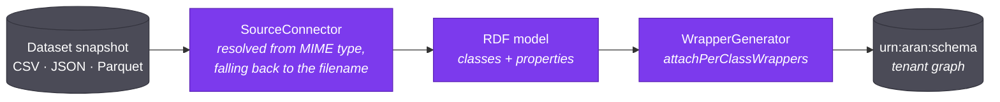

Everything downstream of ingestion reads the schema graph rather than the data.
This page describes what gets written into the graph. It names who writes each
part. It explains what happens when a source stops matching what was written.

## Why RDF at all

The integration could be stored as rows: a mappings table, a classes table, a
joins table. Aran stores it as an RDF graph instead. The reason is simple: the
integration metamodel itself must stay extensible.

An RDF graph is self-describing. A source class carries its own provenance,
format, iterator, and wrapper SQL as triples on the class. As a result, nothing
needs a side table to interpret it. Those triples survive the integration union
without special handling. Merging two source graphs is a graph union, not a
schema migration. The whole graph also stays queryable with SPARQL. Aran
derives the mapping catalog from it at query time, instead of maintaining a
denormalised copy.

The metamodel follows Flores et al. (2024). Its vocabulary namespace is
`http://www.essi.upc.edu/DTIM/NextiaDI/`, abbreviated `nx:` throughout.

## One graph per tenant

The active graph is called `urn:aran:schema`. It lives inside a Fuseki dataset
named after the tenant UUID. This is one active graph **per tenant**, not per
project and not per integration model. A tenant with several integration
models still has only one active graph. A marker triple records which model
owns it. This stops an incremental step from silently building on a graph that
belongs to a different model.

Every change produces a new **graph version**. Each version has a version
number, a status — `DRAFT`, `ACTIVE`, or `HISTORICAL` — and a promotion
timestamp. Versions let you review a compile before it goes live. They also
let you diff a graph against its predecessor.

## What bootstrapping writes

The `bootstrapping` operator reads a snapshot. It emits an RDF description:
one `rdfs:Class` per record type, one `rdf:Property` per field. Source kinds
are pluggable. Each one is a `SourceConnector` that Spring discovers. As a
result, adding a new format does not change the operator. Aran chooses the
connector from the snapshot's MIME type. If that fails, it falls back to the
dataset name's extension. A `format` parameter overrides this and forces a
specific connector.

Each source class then carries:

| Triple | Meaning |
| --- | --- |
| `nx:datasetId` | The dataset this class came from |
| `nx:snapshotId` | The snapshot it was derived from |
| `nx:format` | `CSV`, `JSON`, or `PARQUET` — read by the snapshot resolver at query time |
| `nx:iterator` | What yields one record: `row` for CSV, a JSONPath such as `$`, `$[*]`, or `$.artworks[*]` for JSON |
| `nx:provenance` | The originating dataset id, as a literal |
| `nx:wrapperSql` | The SQL that produces this class's tuples from `${SNAPSHOT}` |

and each source property carries `nx:sourceRef` — the column name for CSV, or the
key relative to the class's iterator for JSON (`title`, or `tags[*]` for an array
of primitives).

Aran writes `nx:provenance` at bootstrap, not at integration time. The timing
matters. Written later, it would be a graph URI resource. Written now, it is
a literal dataset id. A literal survives the integration union unchanged.

`WrapperGenerator.attachPerClassWrappers` then writes one `nx:wrapperSql`
triple per class. It aliases the columns to property IRIs. It leaves the
source as the `${SNAPSHOT}` placeholder. It clears existing wrapper triples
first. As a result, re-bootstrapping is idempotent.

## What integration writes

Integration does not replace the source graph. It adds to the graph instead.
An integrated class or property is an ordinary `rdfs:Class` or `rdf:Property`
that carries an *additional* type, `nx:IntegratedResource`. That is the whole
marker. Anything typed both ways is integrated. Anything typed only the
ordinary way is source-derived.

The rest of the integration vocabulary:

| IRI | Meaning |
| --- | --- |
| `nx:IntegratedResource` | Marks a class or property as integrated |
| `nx:subClassOf` / `nx:subPropertyOf` | Links a source resource to the integrated resource it maps onto |
| `nx:JoinProperty` | Marks an integrated datatype property as having a join representation |
| `nx:joinOnLeft` / `nx:joinOnRight` | The two key columns of a join property |
| `nx:integrationModel` | Records which model owns the graph |

Compiling an integration model also **overrides wrappers**.
`SchemaIntegrationOperator.applyWrapperOverrides` writes the user-edited
wrapper SQL from the model source. It writes that SQL back over the
`nx:wrapperSql` triple on the source class. That loop is the subject of [its
own page](./wrapper-fields.md). Two different fields are called "wrapper".
Only one of them runs.

The operator exposes three operations besides `ping`: `compile` (to a
`DRAFT` version), `incremental-integrate` (add a source onto an
already-promoted schema), and `suggest-alignments`.

## Drift

A source's shape can change after Aran compiles its schema into the active
graph. A column disappears. A type changes. A nested array becomes a scalar.
If re-bootstrapping simply overwrote the source graph, mappings compiled
against the old shape would break. Queries would then fail, with no
explanation.

So bootstrapping does not overwrite the graph. Instead, it computes the
candidate schema. It compares that schema against what the active schema
depends on. If applying it would break something already compiled,
bootstrapping **declines to apply** it. It reports the problem instead. The
dataset becomes `DRIFTED` rather than `READY`. It specifically does not
become `FAILED`. Nothing went wrong, and there is nothing to retry. The
previous source graph is still in place. Queries still work.

Resolving drift is a human decision. You can repair the affected mappings to
match the new shape. Or you can accept the new shape and let the mappings
break. The `force` parameter applies the new schema regardless.

Two read-only operations support this:

- **`drift-check`** reports what re-bootstrapping *would* change, writing nothing.
- **`drift-probe`** checks a live federated table's current schema against its
  recorded baseline. Federated sources have no snapshot to re-read. So the
  check goes to the database.

## How the query engine reads all this back

At query time, `MappingCatalogOperator` runs SPARQL over `urn:aran:schema`.
It builds a `MappingCatalog` from the results. The catalog holds every
integrated class, the source views that unfold into it, and each view's
wrapper SQL. It also holds the global-property → source-column map, the join
properties, and profile-derived row counts.

That catalog is the only thing the planner sees. Aran derives it on demand,
instead of maintaining it as a second copy of the truth. This is the
practical payoff of storing the integration as a queryable graph in the first
place.

## Related

- [The query pipeline](./query-pipeline.mdx) — what happens to the catalog next.
- [The two wrapper fields](./wrapper-fields.md) — the compile/override loop in detail.
- [Core concepts](../overview/core-concepts.md) — the vocabulary used here.
