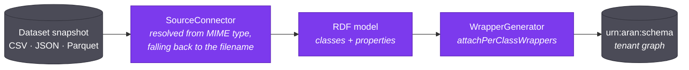

Everything downstream of ingestion reads the schema graph rather than the data.
This page describes what is written into the graph, which component writes each
part, and what happens when a source stops matching what was written.

## Why RDF at all

The integration could be stored as rows in a mappings table, a classes table
and a joins table. Aran stores it as an RDF graph so that the integration
metamodel itself stays extensible.

An RDF graph is self-describing. A source class carries its provenance,
format, iterator and wrapper SQL as triples on the class, so nothing needs a
side table to interpret it, and those triples survive the integration union
without special handling. Merging two source graphs is a graph union and not a
schema migration. The whole graph stays queryable with SPARQL, and Aran
derives the mapping catalog from it at query time instead of maintaining a
denormalised copy.

The metamodel follows Flores et al. (2024). Its vocabulary namespace is
`http://www.essi.upc.edu/DTIM/NextiaDI/`, abbreviated `nx:` throughout.

## One graph per tenant

The active graph is called `urn:aran:schema`. It lives inside a Fuseki dataset
named after the tenant UUID. There is one active graph **per tenant**, not
per project or per integration model, so a tenant with several integration
models still has one active graph. A marker triple records which model owns
it, which stops an incremental step from silently building on a graph that
belongs to a different model.

Every change produces a new **graph version** with a version number, a status
(`DRAFT`, `ACTIVE` or `HISTORICAL`) and a promotion timestamp. Versions let you
review a compile before it goes live and diff a graph against its predecessor.

## What bootstrapping writes

The `bootstrapping` operator reads a snapshot and emits an RDF description:
one `rdfs:Class` per record type and one `rdf:Property` per field. Source
kinds are pluggable. Each is a `SourceConnector` that Spring discovers, so
adding a format does not change the operator. Aran chooses the connector from
the snapshot's MIME type and falls back to the dataset name's extension. A
`format` parameter overrides both and forces a specific connector.

Each source class then carries:

| Triple | Meaning |
| --- | --- |
| `nx:datasetId` | The dataset this class came from |
| `nx:snapshotId` | The snapshot it was derived from; empty for a class read live |
| `nx:format` | `CSV`, `JSON` or `PARQUET` for a file, `JDBC` or `ICEBERG` for a table read live. The snapshot resolver reads it at query time |
| `nx:iterator` | What yields one record: `row` for CSV and Parquet, a JSONPath such as `$`, `$[*]` or `$.artworks[*]` for JSON, the table (or object key) for a source read live |
| `nx:shape` | `FLAT` (one column per property) or `DOCUMENT` (a JSON document the iterator walks). Only JSON bootstrapping writes `DOCUMENT`, and the wrapper is built to match |
| `nx:provenance` | The originating dataset id, as a literal |
| `nx:wrapperSql` | The SQL that produces this class's tuples from `${SNAPSHOT}` |

and each source property carries `nx:sourceRef`: the column name for CSV, or
the key relative to the class's iterator for JSON (`title`, or `tags[*]` for an
array of primitives).

Aran writes `nx:provenance` at bootstrap and not at integration time. Written
later, it would be a graph URI resource. Written at bootstrap, it is a literal
dataset id, and a literal survives the integration union unchanged.

`WrapperGenerator.attachPerClassWrappers` then writes one `nx:wrapperSql`
triple per class. It aliases the columns to property IRIs and leaves the
source as the `${SNAPSHOT}` placeholder. It clears existing wrapper triples
first, so re-bootstrapping is idempotent.

## What integration writes

Integration adds to the source graph and does not replace it. An integrated
class or property is an ordinary `rdfs:Class` or `rdf:Property` that carries
an additional type, `nx:IntegratedResource`. That type is the whole marker:
anything typed both ways is integrated, and anything typed only the ordinary
way is source-derived.

The rest of the integration vocabulary:

| IRI | Meaning |
| --- | --- |
| `nx:IntegratedResource` | Marks a class or property as integrated |
| `nx:subClassOf` / `nx:subPropertyOf` | Links a source resource to the integrated resource it maps onto |
| `nx:JoinProperty` | Marks an integrated datatype property as having a join representation |
| `nx:joinOnLeft` / `nx:joinOnRight` | The two key columns of a join property |
| `nx:integrationModel` | Records which model owns the graph |

Compiling an integration model also overrides wrappers.
`SchemaIntegrationOperator.applyWrapperOverrides` takes the user-edited
wrapper SQL from the model source and writes it back over the `nx:wrapperSql`
triple on the source class. [Its own page](./wrapper-fields.md) covers that
loop. Two fields are called "wrapper", and only one of them runs.

The operator exposes three operations besides `ping`: `compile` (to a
`DRAFT` version), `incremental-integrate` (add a source onto an
already-promoted schema), and `suggest-alignments`.

## Drift

A source's shape can change after Aran compiles its schema into the active
graph: a column disappears, a type changes, a nested array becomes a scalar.
If re-bootstrapping overwrote the source graph, mappings compiled against the
old shape would break and queries would fail with no explanation.

So bootstrapping computes the candidate schema and compares it against what
the active schema depends on. If applying it would break something already
compiled, bootstrapping **declines to apply** it and reports the problem. The
dataset becomes `DRIFTED` rather than `READY`. It does not become `FAILED`,
because nothing went wrong and there is nothing to retry. The previous source
graph stays in place and queries keep working.

Resolving drift is a human decision. You can repair the affected mappings to
match the new shape, or accept the new shape and let the mappings break. The
`force` parameter applies the new schema regardless.

Two read-only operations support this:

- `drift-check` reports what re-bootstrapping would change, and writes nothing.
- `drift-probe` checks a live federated table's current schema against its
  recorded baseline. A federated source has no snapshot to re-read, so the
  check goes to the database.

## How the query engine reads all this back

At query time, `MappingCatalogOperator` runs SPARQL over `urn:aran:schema`
and builds a `MappingCatalog` from the results. The catalog holds every
integrated class, the source views that unfold into it, each view's wrapper
SQL, the global-property to source-column map, the join properties and the
profile-derived row counts.

The planner sees only this catalog. Aran derives it on demand and does not
keep it as a second copy of the truth, which is the payoff of storing the
integration as a queryable graph.

## Related

- [The query pipeline](./query-pipeline.mdx): what happens to the catalog next.
- [The two wrapper fields](./wrapper-fields.md): the compile/override loop in detail.
- [Core concepts](../overview/core-concepts.md): the vocabulary used here.
