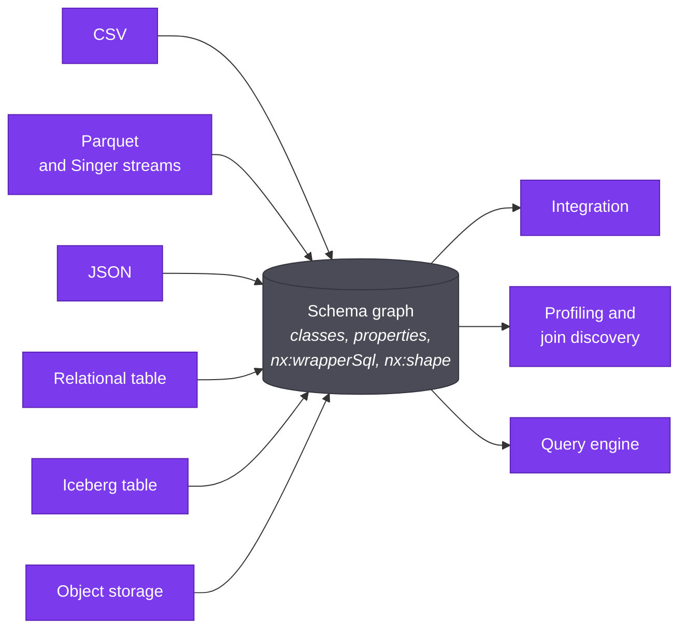

A CSV file, a JSON document, a Postgres table and an Iceberg table have
nothing in common at the byte level. Aran learns the schema of each one in a
different way. What it writes down afterwards is the same thing every time: an
RDFS class per record type, a property per field, and a small set of `nx:`
triples that say how to read the data back.

This page lists the methods, describes the common target model, and states
the rules that hold whichever method ran. For what happens to the graph after
bootstrapping (versions, integration, drift), see
[Bootstrapping and the schema graph](./bootstrapping-and-the-schema-graph.mdx).
For the steps to run it, see
[Bootstrap and profile a dataset](../how-to/bootstrap-and-profile-a-dataset.md).

## One method per source kind

Each source kind has a `SourceConnector`, a Spring component that claims a
source descriptor and learns its schema. The interface has three methods:
`sourceKind` names the kind, `supports` says whether the connector claims a
descriptor, and `introspect` returns the RDFS graph. Startup refuses two
connectors with the same kind. For a snapshot, a caller can force a kind with the
bootstrap operation's `format` parameter (`CSV`, `JSON` or `PARQUET`). Otherwise
exactly one connector must claim the descriptor, and a descriptor that two connectors claim is refused as ambiguous
when it is resolved.

`introspect` learns the schema and nothing else. A file connector may read the
snapshot bytes it is handed. For a database, a catalogue or an object store, it
may use only the catalogue or a `DESCRIBE`, and it must not pull rows into
memory. Reading the data later is not the connector's job.

| Source kind | How it reaches bootstrapping | Method | `nx:shape` | What is derived |
| --- | --- | --- | --- | --- |
| CSV | A snapshot in the lake. Claimed by content type or a `.csv`/`.tsv` name. | Reads the header row after detecting the delimiter (tab, then semicolon, then comma). | `FLAT` | One class per file, one property per column, every column typed `xsd:string`. |
| Parquet | A snapshot in the lake. Claimed by content type or a `.parquet` name. | Runs DuckDB `DESCRIBE` over the file. | `FLAT` | One class per file, one property per column, typed from the DuckDB column type. |
| JSON | A snapshot in the lake. Claimed by content type or a `.json` name. | Walks the document, or its first element when the root is an array. Arrays of objects are read from their first element. | `DOCUMENT` | One class per object, including nested objects and arrays of objects. One property per key. Primitives typed from the value. |
| Relational table (JDBC) | The live catalogue of a federated repository. No snapshot exists. | Reads the table's columns through JDBC metadata. | `FLAT` | One class per table, one property per column, typed from the JDBC type. |
| Iceberg table | The live REST catalogue. No snapshot. | Reads the table schema from the catalogue's own table response. | `FLAT` | One class per table, one property per field, typed from the Iceberg type. |
| Object storage | A live object in a bucket. No snapshot. | Runs `DESCRIBE` over the reader for the object's format, on top of a server-side S3 credential. | `FLAT` | One class per object, one property per top-level field. |
| Singer stream | A snapshot in the lake, as Parquet. | None of its own. The tap runs, its records land as a Parquet file through the same upload tail as a file upload, and bootstrapping is handed the name `<stream>.parquet`. The Parquet method then runs. | `FLAT` | As for Parquet. |

Relational and Iceberg tables can also be copied into the lake. A copy is a
Parquet snapshot, uploaded under the name `<table>.parquet`, so it is
bootstrapped by the Parquet method. Which of the
two the query engine reads for a given dataset is a separate decision, made
per dataset. See the [repository pages](../repositories/index.md) for each
kind.

A Singer tap has no connector because there is nothing new to learn: by the
time bootstrapping sees the stream it is a Parquet snapshot. See
[Singer taps](../repositories/singer-taps.md).

The object-storage method is built and tested, but the
[status page](../overview/status.md) says which registration paths reach it.

## The common target model

Every method calls the same helper, `WrapperVocab.attachClassWrapper`, for
each class it creates. The graph therefore carries the same triples on a
source class whatever produced it:

| Triple on a source class | Holds |
| --- | --- |
| `nx:datasetId` | The dataset the class came from. |
| `nx:snapshotId` | The snapshot it was derived from, or an empty string for a live source. |
| `nx:format` | The reader name: `CSV`, `PARQUET`, `JSON`, `JDBC`, `ICEBERG`, or the object's own format. |
| `nx:iterator` | What yields one record. `row` for CSV and Parquet, a JSONPath for JSON, the table name or identifier for a relational or Iceberg table, the object key for object storage. |
| `nx:shape` | `FLAT` or `DOCUMENT`. |
| `nx:provenance` | The originating dataset id, as a literal. |
| `nx:wrapperSql` | The SQL that produces the class's tuples from `${SNAPSHOT}`. Attached afterwards by `WrapperGenerator`. |

Each source property carries `rdfs:domain` (its class), `rdfs:range` (an
`xsd:` type, or another class for a nested object), and `nx:sourceRef`, which
is the column name or, for JSON, the key relative to the class's iterator.

For a non-file source the iterator is the relation to read and not a record
shape. That is why a table name sits in the same slot as a JSONPath.

### From model to wrapper SQL

`WrapperGenerator.attachPerClassWrappers` asks `WrapperSqlBuilder` for one
`SELECT` per class. The builder collects the class's leaf properties, meaning
those whose range is an `xsd:` type. Object properties that point at another
class become joins and not columns.

Then it branches on `nx:shape`:

- A `FLAT` class projects one column per property: `SELECT "col" AS "<property IRI>", … FROM ${SNAPSHOT}`.
- A `DOCUMENT` class parses its iterator into struct-field accesses and `UNNEST` laterals, then projects each property off the resulting row expression.

Either way the columns are aliased to full property IRIs, which do not collide
across sources the way labels do. The SQL ends in the `${SNAPSHOT}`
placeholder, which the consumer binds later. [The two wrapper
fields](./wrapper-fields.md) explains which copy of the SQL runs.

### Types

Bootstrapping records a type as an `rdfs:range` and does not cast anything.
The methods differ in how much they know.

- CSV types every column `xsd:string`, and nothing later rewrites that range: profiling measures the values but leaves the graph alone. The query engine therefore reads every CSV column as text. Upload Parquet when column types matter.
- Parquet and object storage map the DuckDB column type to `xsd:string`, `xsd:integer`, `xsd:double`, `xsd:decimal`, `xsd:boolean`, `xsd:date` or `xsd:dateTime`. Anything else, including `INTERVAL`, becomes `xsd:string`.
- JDBC maps the JDBC type in the same way, with `BIGINT` as `xsd:long` and time-of-day columns as `xsd:time`.
- Iceberg maps its own type system.
- JSON reads the type off the first value: `xsd:boolean`, `xsd:integer`, or `xsd:double` for any non-integral number. A null or an empty array defaults to `xsd:string`.

Widening happens later, in the query engine. When several sources contribute
to one integrated class, the engine folds their ranges pairwise. Equal types
stay as they are. `BIGINT` with `DECIMAL` gives `DECIMAL`, and `BIGINT` or
`DECIMAL` with `DOUBLE` gives `DOUBLE`. Every other disagreement, including
`DATE` against `TIMESTAMP`, falls back to `VARCHAR` and never fails the
compile. A range the engine has no SQL type for, `xsd:time` included, is read as
`VARCHAR` too.

## Rules that hold across methods

Shape is explicit. A connector states `FLAT` or `DOCUMENT` when it writes the
class, and `WrapperSqlBuilder` reads that triple. It does not infer the shape
from `nx:format`. A format names a reader and does not say whether the rows are
flat: an Iceberg table inferred as a document would get a wrapper that reads
`"db"."researchers"` as a struct path and binds to nothing. Only the JSON
method writes `DOCUMENT`. Even a JSON object read from a bucket is `FLAT`,
because there the columns come from `DESCRIBE`, one per top-level field. A graph written before `nx:shape` existed still gets a
format-based inference, narrowed to "JSON means document".

Arrays follow three rules, all in the JSON method:

- An array of objects becomes its own class, with an iterator ending in `[*]`.
- An array of primitives stays a property of the owning class and is unnested to rows, one row per element.
- A JSON object with two array-of-primitive fields is refused. Two `UNNEST` laterals over one row are a cross join, so a record with three tags and two colours would become six rows and multiply every count. Bootstrapping fails with `BOOTSTRAP_FAILED`, the job fails and the dataset is marked `FAILED`. The message names the object's path and both fields and says that unnesting both would multiply every row. `WrapperSqlBuilder` repeats the refusal for a graph that reached it another way: that class then gets no wrapper, and a warning is logged.

Arrays are never flattened to `LIST` columns. Restructure or remove one of the
two fields, or split the array into objects.

Two more rules complete the picture. A class with no leaf properties gets no
wrapper. And re-running a method is idempotent, since `WrapperGenerator`
clears the old wrapper triples first.

The connector contract kit enforces the model. The CSV, Parquet, JSON, JDBC and
Iceberg connector tests extend `SourceConnectorContract` (in `aran-core`'s test
fixtures), which fails a connector whose classes omit `nx:shape` or declare a
shape other than the one the kind is expected to have. A new kind whose test
extends the kit cannot ship a class that downstream stages would have to guess
about. The object-storage connector does not run the kit yet.

## What the common model buys

The consumers on the right never branch on the kind of source. Integration
aligns classes and properties, profiling measures columns of a class, and
the query engine builds its mapping catalog with SPARQL over the graph and
unfolds each source view through its wrapper SQL. The only per-kind decision
downstream is how the `${SNAPSHOT}` placeholder is bound: a view over a lake
snapshot, or a live scan of the source. That decision lives in the query
engine's resolver and not in the graph.

The same property makes a new kind cheap. A connector that emits the target
model, and declares its shape, gets integration, profiling, join discovery and
querying without a change to any of them.

## Related

- [Bootstrapping and the schema graph](./bootstrapping-and-the-schema-graph.mdx): versions, integration and drift.
- [The two wrapper fields](./wrapper-fields.md): which wrapper SQL runs.
- [Write wrapper SQL](../how-to/write-wrapper-sql.md): editing the SQL a class runs.
- [Repositories](../repositories/index.md): the source kinds from the user's side.
