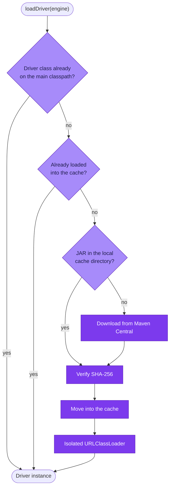

Aran connects to database engines whose JDBC drivers it does not ship. Instead
of bundling every driver it might ever need, Aran fetches only the one it
needs. It verifies the driver and loads it into an isolated class loader.
This is the same pattern desktop database clients such as DBeaver use.

## Why not just bundle them

Bundling every supported driver means a larger image and a larger classpath.
It also means a set of transitive dependencies the application never uses.
Aran must still keep those dependencies current for CVEs. Bundling also fixes
the driver version at build time. So supporting a customer on an older
database means rebuilding.

## The registry

`JdbcDriverRegistry` is a static table with one entry per engine. Each
`DriverMetadata` entry carries the Maven coordinates, the driver class
name, and the JDBC URL template — with `{host}`, `{port}`, and
`{database}` placeholders. It also carries the download URL on Maven
Central and — critically — the **expected SHA-256 of the JAR**.

Six engines are registered today:

| Engine | Driver | Version pinned in the registry |
| --- | --- | --- |
| `POSTGRESQL` | `org.postgresql.Driver` | 42.7.5 |
| `MYSQL` | `com.mysql.cj.jdbc.Driver` | 9.2.0 |
| `MARIADB` | `org.mariadb.jdbc.Driver` | 3.5.2 |
| `ORACLE` | `oracle.jdbc.OracleDriver` | 23.6.0.24.10 |
| `SQLSERVER` | `com.microsoft.sqlserver.jdbc.SQLServerDriver` | 12.8.1.jre11 |
| `HBASE` | `org.apache.phoenix.queryserver.client.Driver` (Phoenix thin) | 6.0.0 |

`SQLSERVER`'s URL template is
`jdbc:sqlserver://{host}:{port};databaseName={database};encrypt=false`;
`HBASE` connects through the Phoenix Query Server,
`jdbc:phoenix:thin:url=http://{host}:{port}`.

Aran cannot connect to an engine that is not in the registry — the request
fails with *Unsupported database engine: \<engine\>*. The registry is a
static initializer in a final class, so adding an engine is a one-entry
code change and a rebuild; nothing else in the codebase changes.

## Resolution order

**The classpath fast path applies to every engine, not only PostgreSQL.** If
the driver class is already resolvable, Aran instantiates it directly and
downloads nothing. PostgreSQL happens to be on the classpath, because the
platform's own database is PostgreSQL — so it never goes through the
download path in practice. That is a consequence of the fast path, not a
special case in the code.

## What makes it safe

**Aran verifies every JAR against a pinned SHA-256**, whether it was just
downloaded or found in the cache. If a cached file fails verification, Aran
deletes it and re-fetches it instead of using it. If a downloaded file fails
verification, Aran never moves it into the cache: the download lands in a
temp file first, and only a verified file is moved into place. So a partial
or interrupted download is never mistaken for a valid cached driver. (The
move itself is a plain replace, not an atomic filesystem operation — the
guarantee is the verify-then-move ordering.)

**Each driver gets its own `URLClassLoader`**, parented to the application's
loader. Two drivers that depend on incompatible versions of the same library
do not collide. Neither pollutes the application classpath.

**Loading is cached and single-flight.** Aran holds loaded drivers in a
`ConcurrentHashMap`, behind a double-checked lock, so concurrent
connection tests for the same engine load the driver only once. Without that,
every connection test would build a new class loader. That would leak
metaspace and file handles.

**Unloading is explicit.** `unloadDriver` deregisters the driver from
`DriverManager` and closes the class loader. This releases the JAR's file
handle. The component implements `DisposableBean`, so shutdown cleans up.

The HTTP client respects the system proxy selector. This is what lets driver
downloads work in deployments that route outbound traffic through a proxy.

## Operational consequences

- **Aran needs outbound access to Maven Central**, once per engine per cache
  directory. An air-gapped deployment must pre-populate the cache directory
  instead.
- **You configure the cache directory** with `aran.jdbc.driver-cache-dir`. By
  default, it is `drivers`, relative to the working directory. Aran creates it
  at startup if it is missing. In a container, mount it as a volume or accept
  re-downloads on every restart.
- **A failed download surfaces at connection-test time**, not at startup —
  as *Failed to download driver JAR from Maven Central. HTTP status: …*.
  The registry entry exists whether or not the JAR has ever been fetched.
- **An unregistered engine** fails with *Unsupported database engine: …*.

## Related

- [Relational databases](../repositories/relational-databases.md) — the engines this serves.
- [Operational troubleshooting](../administration/troubleshooting.md) — when a driver will not load.
