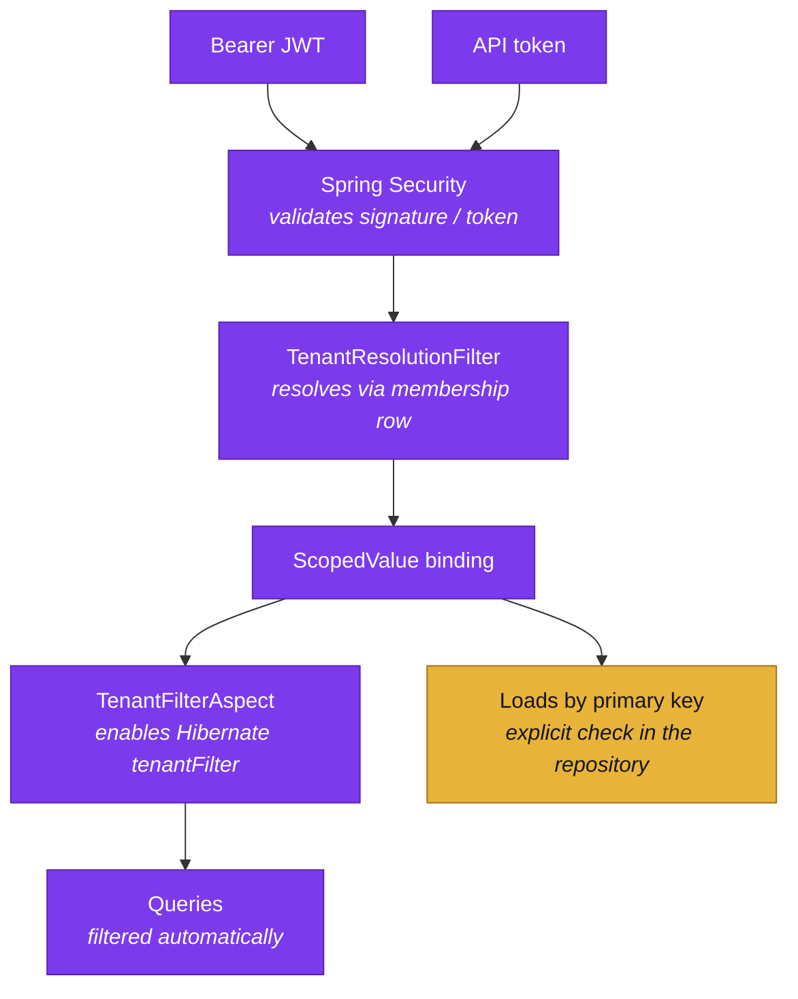

Aran is multi-tenant on a shared schema with a discriminator column. Every
tenant-owned row carries a tenant id, and Aran filters queries by it. This page
covers how the id reaches the persistence layer and where the filtering is and
is not automatic.

## Where the tenant comes from

From Aran's own `membership` row, and never from a header, a query parameter,
a body field or a token claim. A caller could set any of the first three to
someone else's tenant. Tenancy used to come from the fourth, a Keycloak user
attribute (`tenant_id`) that nothing kept in agreement with the membership
table and that needed a Keycloak admin action to move someone between tenants.
Aran's own database is now the single answer.

`TenantResolutionFilter` runs after Spring Security's authentication filters,
which is what its very late `@Order` is for. By then the caller is already
authenticated through one of two paths:

- A JWT session. The filter asks `CurrentUserResolver` for the caller's
  identity, then `IdentityService.soleMembership(userId)` for their one
  membership row.
- An API token. `ApiTokenAuthentication` already carries the token
  owner's tenant id, resolved when the token itself was looked up.

Both paths bind through the same `TenantContextHolder.runWith` call, so a
token-authenticated request (the JDBC endpoint, the Python SDK) is filtered
exactly like a browser request. That symmetry is recent. The filter used to
read the JWT claim and leave API-token requests unbound, so an endpoint that
relied on the Hibernate filter and not on an explicit tenant check ran
unfiltered for token callers.

A request with no resolvable tenant, such as the public `GET /api/health` or
an authenticated caller with no membership, passes through with nothing bound and
does not get a default tenant. If it reaches tenant-scoped code,
`TenantContextHolder.require()` throws, and that loud failure is intended.

There is no tenant switcher, because a user holds at most one membership.
`uq_membership_user` (V23) enforces that in the database, and `soleMembership`
refuses to guess if it finds more than one. A person who needs two tenants
holds two Aran users, as one person can hold two Google accounts. This is also
why the browser end-to-end suite runs one Keycloak user per spec.

## Why `ScopedValue` and not `ThreadLocal`

`TenantContextHolder` uses `ScopedValue`, standard as of Java 25, instead of
`ThreadLocal`, for three reasons:

- Immutability within the scope. Nothing can reassign a scoped value for
  the duration of a bound scope, so a downstream call cannot silently change
  the caller's tenant.
- Safe inheritance across forks. Structured-concurrency forks inherit the
  binding cheaply, without the leak risk `ThreadLocal` carries on pooled
  platform threads. Request handling runs on virtual threads, so that risk
  applies here.
- No teardown to forget. With the `where(...).run(...)` shape the binding ends
  when the block ends, and there is no `clear()` for a code path to skip.

```java
TenantContextHolder.runWith(tenant, () -> {
    // everything called transitively from here sees this tenant
});
// binding is gone

// The value-returning twin, used by the operator orchestrator:
var result = TenantContextHolder.callWith(tenant, () -> orchestrate(request));
```

As a result, services do not take a tenant argument or thread one through
their call chains. Operators are the exception: an `OperatorRequest` carries
`tenantId` explicitly, because operators run from job threads as well as
request threads and should not depend on ambient state.

## Where enforcement actually happens

Enforcement is in the persistence adapter and not in each query.
`TenantFilterAspect` enables a Hibernate `@Filter` on tenant-owned entities
before each call into a tenant-scoped JPA repository, reading the bound context
(or, when nothing is bound, a `TenantContext` passed as the call's first
argument). Queries planned while it is on carry
the tenant predicate whether or not the query's author remembered it.

The filter does not cover loads by primary key. Hibernate consults `@Filter`
only when it plans a query, and a `find`-by-id goes straight to the entity
cache and the row. The JPA repositories therefore carry explicit tenant checks
on their by-id reads and deletes, and several say so in comments at the top of
the file. The list queries keep their explicit predicate as well, as defence in
depth, even though the filter covers them.

This is the one place where "enforced centrally" is not the whole truth:
developers check reads and writes by id by hand. A new repository method that
loads by id needs the same check.

The JDBC endpoint applies the same discipline outside JPA. A statement handle
is a guessable integer, so a `fetch` re-verifies that the tenant fetching a
statement is the tenant that opened it and does not trust the handle.



## What is isolated

| Resource | Isolation |
| --- | --- |
| Platform tables (projects, repositories, datasets, jobs, licences) | Tenant discriminator column, Hibernate filter plus explicit by-id checks |
| Schema graph | One Fuseki dataset per tenant UUID; the active graph is `urn:aran:schema` inside it |
| Lake snapshots | Addressed by dataset, which is itself tenant-owned |
| Operator invocations | `OperatorRequest.tenantId`, passed explicitly |

## Related

- [Architecture](../overview/architecture.mdx): where the filter sits in the request path.
- [Core concepts](../overview/core-concepts.md): tenants, projects and users.
