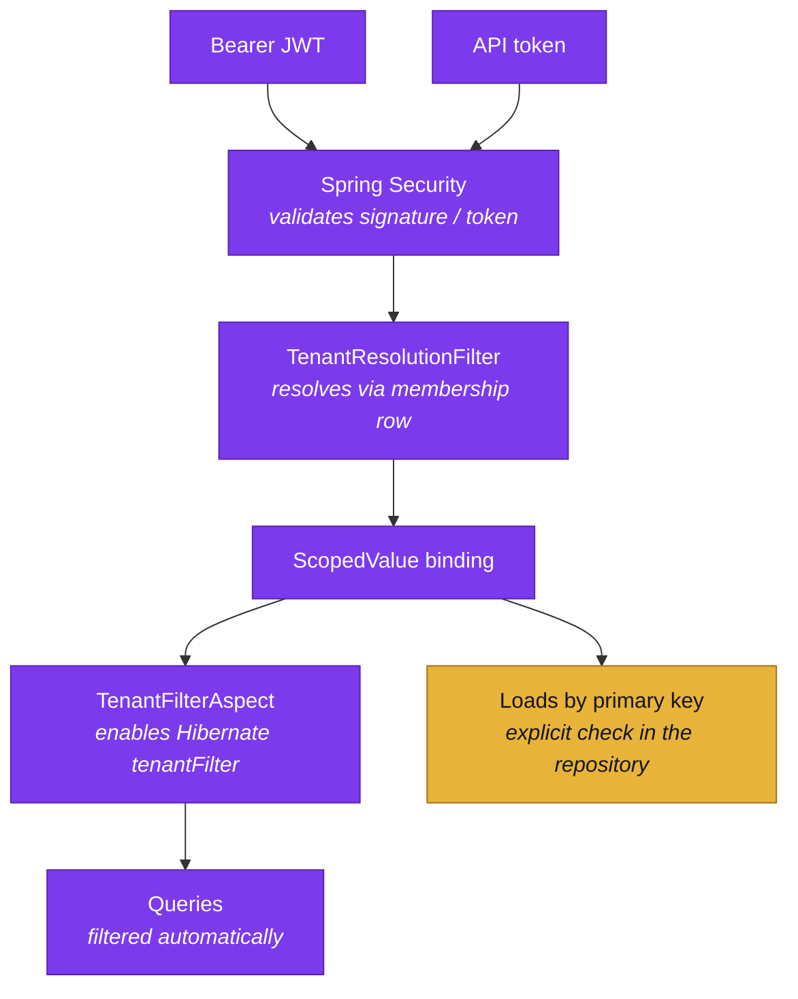

Aran is multi-tenant on a shared schema with a discriminator column. Every
tenant-owned row carries a tenant id. Aran filters every query by that id.
The interesting parts are how the id gets there, and where the filtering is
— and is not — automatic.

## Where the tenant comes from

From Aran's own `membership` row — never from a header, a query parameter, a
body field, or a token claim. A caller could set any of the first three to
someone else's tenant. Tenancy used to come from the fourth: a Keycloak user
attribute (`tenant_id`) that nothing kept in agreement with the membership
table, and that required a Keycloak admin action just to move someone
between tenants. Aran's own database is now the single answer.

`TenantResolutionFilter` runs after Spring Security's authentication filters.
That is what the very late `@Order` is for. By then, the caller is already
authenticated, through one of two paths:

- **A JWT session.** The filter asks `CurrentUserResolver` for the caller's
  identity, then `IdentityService.soleMembership(userId)` for their one
  membership row.
- **An API token.** `ApiTokenAuthentication` already carries the token
  owner's tenant id, resolved when the token itself was looked up.

Both paths bind through the same `TenantContextHolder.runWith` call, so a
token-authenticated request — the JDBC endpoint, the Python SDK — is filtered
exactly like a browser request. That symmetry is recent: this filter used to
read the JWT claim and leave API-token requests unbound, so an endpoint that
relied on the Hibernate filter rather than an explicit tenant check ran
unfiltered for token callers.

A request with no resolvable tenant — a public actuator endpoint, or an
authenticated caller who holds no membership — passes through with nothing
bound. It does not get a default tenant. If such a request somehow reaches
tenant-scoped code, `TenantContextHolder.require()` throws. A loud failure is
the desired behaviour.

There is no tenant switcher, in-session or otherwise, because there is
nothing to switch between: a user holds **at most one** membership —
`uq_membership_user` (V23) enforces it at the database, and `soleMembership`
refuses to guess if it somehow finds more than one. A person who needs two
tenants holds two Aran users, the way one person can hold two Google
accounts. This is also why the browser end-to-end suite runs one Keycloak
user per spec.

## Why `ScopedValue` and not `ThreadLocal`

`TenantContextHolder` uses `ScopedValue`, standard as of Java 25, instead of
`ThreadLocal`. Three properties motivated that choice:

- **Immutability within the scope.** Nothing can reassign a scoped value for
  the duration of a bound scope, so a downstream call cannot silently change
  the caller's tenant.
- **Safe inheritance across forks.** Structured-concurrency forks inherit the
  binding cheaply, without the leak risk `ThreadLocal` carries on pooled
  platform threads. Request handling runs on virtual threads. This makes the
  risk concrete, not theoretical.
- **No teardown to forget.** The `where(...).run(...)` shape means the binding
  ends when the block ends. There is no `clear()` that a code path can skip.

```java
TenantContextHolder.runWith(tenant, () -> {
    // everything called transitively from here sees this tenant
});
// binding is gone

// The value-returning twin, used by the operator orchestrator:
var result = TenantContextHolder.callWith(tenant, () -> orchestrate(request));
```

The consequence for everyday code is that services do not take a tenant
argument. They also do not thread one through their call chains. Operators
are the exception. An `OperatorRequest` carries `tenantId` explicitly.
Operators run from job threads as well as request threads. So they should
not depend on ambient state.

## Where enforcement actually happens

In the persistence adapter, not in each query. `TenantFilterAspect` enables a
Hibernate `@Filter` on tenant-owned entities, per request, reading the bound
context. Queries planned while it is on carry the tenant predicate whether or
not the author of the query remembered it.

**The filter does not cover loads by primary key.** Hibernate consults
`@Filter` only when it plans a *query*. A `find`-by-id instead goes straight
to the entity cache and the row. No filter applies there. So the JPA
repositories carry explicit tenant checks on their by-id reads and deletes.
Several of them say so in comments at the top of the file. The list queries
keep their explicit predicate too, as defence in depth. This is true even
though the filter also covers them.

This is worth stating plainly because it is the one place where "enforced
centrally" is not the whole truth. Developers check reads and writes *by id*
by hand. A new repository method that loads by id needs that same check
written into it.

The JDBC endpoint is a concrete instance of the same discipline outside
JPA: a statement handle is a guessable integer, so a `fetch` re-verifies
that the tenant fetching a statement is the tenant that opened it, rather
than trusting the handle.



## What is isolated

| Resource | Isolation |
| --- | --- |
| Platform tables (projects, repositories, datasets, jobs, licences) | Tenant discriminator column, Hibernate filter plus explicit by-id checks |
| Schema graph | One Fuseki dataset per tenant UUID; the active graph is `urn:aran:schema` inside it |
| Lake snapshots | Addressed by dataset, which is itself tenant-owned |
| Operator invocations | `OperatorRequest.tenantId`, passed explicitly |

## Related

- [Architecture](../overview/architecture.mdx) — where the filter sits in the request path.
- [Core concepts](../overview/core-concepts.md) — tenants, projects, and users.
