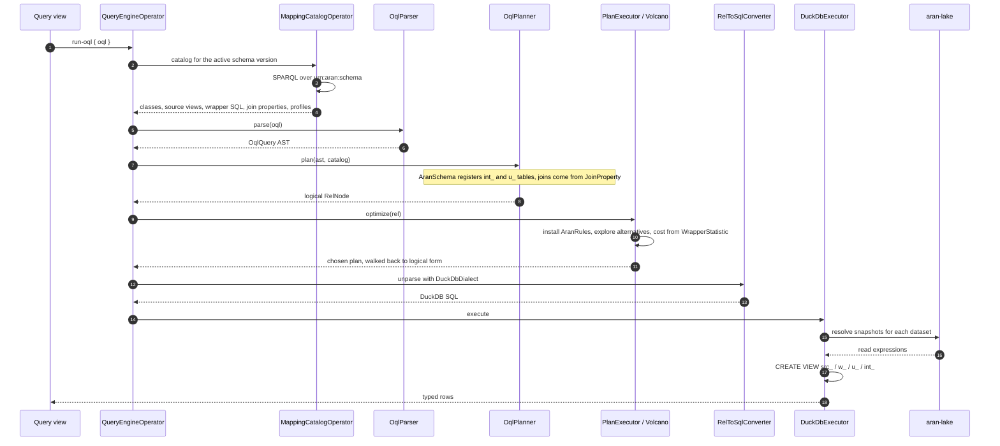

An OQL query names integrated classes that do not exist as tables anywhere.
Turning it into something a database can run means unfolding those classes
into the source views behind them. It also means choosing between the
several correct SQL statements that unfolding permits. This page describes
how that happens.

## The stages

```
OQL string
  → OqlParser.parse()          hand-written lexer + recursive-descent parser
  → OqlPlanner                 AST → Calcite RelNode, over a schema derived from the mapping catalog
  → PlanExecutor.optimize()    one VolcanoPlanner pass over AranRules, costed from profile statistics
  → RelToSqlConverter          + DuckDbDialect
  → DuckDbExecutor             creates src_/w_/u_/int_ views, runs the SQL
```

There is exactly one query pipeline. Aran deleted an earlier string-rewriting
path, `OqlRewriter`. Nothing falls back to it.



## Parsing

`OqlParser` is a hand-written lexer plus recursive-descent parser — no
generated grammar. It produces an `OqlQuery` AST. The full accepted grammar
is in the [syntax reference](../oql/syntax-reference.md). The shape is:

```
query := SELECT projList [FROM pathExpr] [WHERE conj]
         [GROUP BY groupList] [HAVING havingConj] [ORDER BY orderList] [LIMIT int]
```

with the distinguishing production being the path expression:

```
pathExpr := ClassName ('-[' ident ']->' ClassName)*
```

## Planning

`OqlPlanner` lowers the AST to a Calcite `RelNode` tree, against `AranSchema`.
`AranSchema` is a Calcite schema built from the mapping catalog, not from a
database's information schema.

`AranSchema` registers **two levels** of the unfolding as tables:

- `int_<class>` — the integrated class, with statistics summed across its sources.
- `u_<dataset>_<class>` — one per union member, each carrying that source's own
  row count and keys.

Both are real DuckDB views. A plan may reference either. Registering the
members is what lets `UNION ALL` appear in the `RelNode` tree at all. Without
it, the union is invisible to the planner. Per-source statistics would also
get aggregated away before the cost model can use them.

A third level appears when a wrapper is planned through. Probing an
[Optimizable wrapper](../query-engine/wrapper-optimisation.md) registers
`src_<dataset>` — the raw snapshot relation — in a throwaway one-table
schema, and an expanded member's plan bottoms out in a scan of that `src_`
relation instead of the opaque `u_` view. That is what lets a query
predicate travel inside the wrapper.

Plans come out in one of two shapes:

| Query kind | Shape |
| --- | --- |
| Non-aggregate | Scan → [Join] → [Filter] → Project → [Limit] |
| Aggregate | Scan → [Join] → [Filter] → Aggregate → [HavingFilter] → [Limit] |

Joins are not inferred. Each `-[prop]->` step resolves to a `JoinProperty`
from the catalog. That `JoinProperty` carries the two integrated-class IRIs.
It also carries the two global property IRIs that are the key columns. The
planner uses those directly.

## Optimisation

`PlanExecutor.optimize` runs a **single VolcanoPlanner pass**. Logical
rewrites and physical conversion happen together. The planner explores every
rewrite as a costed alternative. It never applies a rewrite just because it
matched.

**The rule set is owned, not inherited.** A planner from `RelBuilder.create`
arrives preloaded with Calcite's full default preparation set — 113 rules.
`AranRules.install` empties it and installs only what
Aran wants. That is not tidiness. One of the default rules, merge join,
asked for a collation that nothing else needed. That collation seeded a node
in the plan. The extra node made `JoinUnionTransposeRule` abort planning
outright.

**There is no heuristic pre-pass.** A `HepPlanner` phase used to run first.
The reason: the logical rewrites appeared not to survive in Volcano alongside
the Enumerable rules. That turned out to be a consequence of the inherited
rule set rather than of Volcano. Removing the Hep phase is what makes the
join-below-union rewrite a real decision. Under Hep, the rewrite fired
whenever it matched. As a result, it needed an arbitrary cap on how many
branches it could produce. Under Volcano, both shapes stay in the `RelSet`
instead. The cheaper one wins.

Costs come from `AranRelMdRowCount` over `WrapperStatistic` — per-source row
counts and keys derived from FREYJA profiles. A dataset that has never been
profiled reports a row count of zero. That zero becomes Calcite's
`Statistics.UNKNOWN`. The optimiser still produces a correct plan. It just
has no basis for choosing between alternatives.

The chosen physical plan is walked back to logical form before unparsing.
This step exists because `RelToSqlConverter` cannot unparse physical nodes.

## SQL generation and execution

`RelToSqlConverter` with `DuckDbDialect` produces the SQL text. `DuckDbExecutor`
then creates the view stack described in
[Core concepts](../overview/core-concepts.md#views-src_-w_-u_-int_) and runs it.

At this point, `DuckDbExecutor` substitutes `${SNAPSHOT}` in each wrapper
with the `src_` view name. The **snapshot resolver** decides what `src_`
itself reads. This is where the federated path lives:

- Ordinary datasets download their lake snapshot to a temp file and read it with
  the function the format requires. The format-specific expression
  (`read_parquet` and friends) belongs here, keyed off `nx:format`, and never
  inside wrapper SQL.
- Relational repositories flagged `federated` resolve to a live read
  instead: a table of the source database attached read-only under
  `aran_attach_<repository>`. For PostgreSQL, MySQL and MariaDB alike, the
  connection runs a temporary secret and the `ATTACH` before the views. As a result, the query reads the source
  database directly. Only PostgreSQL, MySQL, and MariaDB can be federated.
  The schema-drift probe and federated profiling share that same read. As a
  result, neither can end up connecting somewhere subtly different from where
  queries go.

Only the classes a statement names are materialised. The executor extracts
the referenced classes from the generated SQL before creating views, so a
query over one class does not download every source of every class.

DuckDbExecutor converts results to JSON, preserving their types wherever
JSON can represent them without loss. Integers, booleans, strings, and
doubles pass through unchanged. A `BIGINT` outside JavaScript's
safe-integer range becomes a string instead: `JSON.parse` would silently
round it, and a silently rounded number is worse than a string.
DuckDbExecutor stringifies `BigDecimal`, `HUGEINT`, dates, timestamps,
arrays, and structs for the same reason — JSON also has no native form for
them.

### The row cap and paging

`run-oql` and `run` cap a response at 1000 rows. The cap is applied by
wrapping the whole statement as a subquery and putting `LIMIT`/`OFFSET`
outside it — so a trailing `;`, a string literal containing `no limit
here`, or a trailing `--` comment cannot defeat it. One visible consequence
of the wrapping: duplicate output column names come back with DuckDB's
de-duplicated labels (`name`, `name_1`).

Both operations take an `offset` parameter (default `"0"`). A page's
payload carries:

| Key | Meaning |
| --- | --- |
| `headers`, `headerNames` | Column metadata |
| `rows` | Up to `pageSize` rows |
| `rowCount` | Rows in **this page only** |
| `offset` | The offset this page starts at |
| `pageSize` | 1000 |
| `hasMore` | Whether another page exists |
| `truncated` | Alias of `hasMore` |
| `elapsedMs` | Execution time |

## What the operator exposes

The pipeline is reachable through the `query-engine` operator:

| Operation | Does |
| --- | --- |
| `run-oql` | Parse, plan, optimise, execute; returns capped rows, paged by `offset` |
| `rewrite-oql` | Everything except execution; returns the generated SQL |
| `run` | Execute raw SQL against the source tables and `int_` views, skipping OQL entirely; same cap, same `offset` |
| `explain` | Return the view DDL the engine would materialise |
| `catalog` | Return the mapping catalog the planner works from |
| `materialize-oql` | Execute and write the full, uncapped result to a file |
| `materialize-product-sql` | Plain SQL over data products, uncapped, to a file. No GAV rewrite for a materialised product; a virtual product reached this way is bound as a live view over its expanded OQL |
| `materialize-source-sql` | Plain SQL over the source tables, uncapped, to a file |
| `preview-parquet` | Read rows back from a materialised snapshot |
| `validate-constraint` | Check a SQL predicate against a class |
| `verify-wrapper` | Run the [wrapper round-trip check](../query-engine/wrapper-optimisation.md) for a `datasetId`/`classIri`/`sql` triple |

`run-oql` caps its response at 1000 rows. This stops a broad `SELECT` from
producing an unbounded payload. `materialize-oql` is the uncapped path. It
writes to a file instead of to the response.

## Related

- [OQL syntax reference](../oql/syntax-reference.md) — what the parser accepts.
- [SQL mode](../oql/sql-fallback.md) — going straight to the source tables or `int_` views.
- [The two wrapper fields](./wrapper-fields.md) — which wrapper the executor actually reads.
- [Typed columns and cost-based plans](../query-engine/typed-columns-and-costing.md) — the same pipeline described without the internals.
- [Optimizable and opaque wrappers](../query-engine/wrapper-optimisation.md) — when the planner can see inside a wrapper.
- [Referential evidence and join removal](../query-engine/referential-evidence.md) — the rewrite that drops a redundant join.
