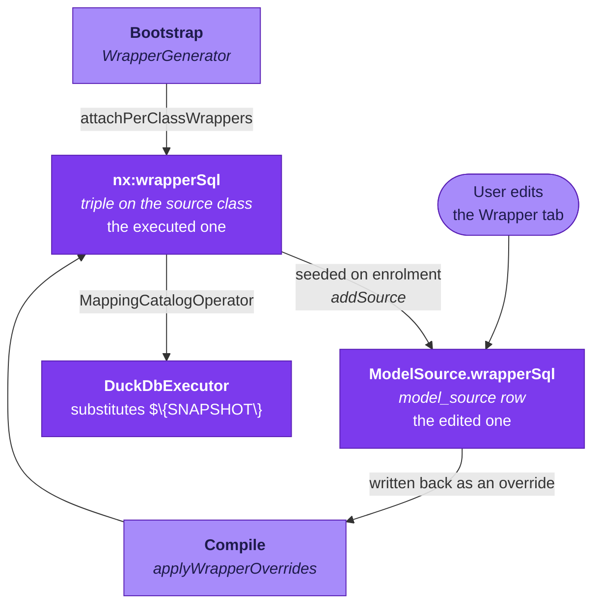

Two separate fields in Aran are called "wrapper". They hold similar-looking
SQL, and bootstrap populates both from the same original source. Only one of
them is ever executed, so editing the wrong one silently changes nothing about
any query result.

## The two

| Field | Written by | Read by |
| --- | --- | --- |
| **`nx:wrapperSql`**, a triple on each source class in the schema graph | `WrapperGenerator.attachPerClassWrappers` at bootstrap; overwritten by `SchemaIntegrationOperator.applyWrapperOverrides` at compile | **`MappingCatalogOperator` → `MappingCatalog.SourceView.wrapperSql` → `DuckDbExecutor`, where `${SNAPSHOT}` is substituted. This is the one that runs.** |
| **`ModelSource.wrapperSql`**, a column on the `model_source` row | Seeded from the class's `nx:wrapperSql` by `IntegrationModelService.addSource`; edited through `PUT /model/sources/{datasetId}/wrappers` | Pushed back into the graph as an override at compile time. **This is the one a user edits.** |

## The loop

In order: bootstrap writes the graph triple, and enrolling a source in an
integration model copies it into the model row. The user edits the model row.
Compiling writes the model row back over the graph triple, and the executor
reads the graph triple.

## A third field, once

A third field, `Dataset.wrapper`, was written at bootstrap and read by
nothing. Migration `V27__drop_dataset_wrapper.sql` deleted it, so a `wrapper`
field on `Dataset` appears only in old branches and stale API payloads.

## The preview endpoint does not read either persisted field

`DatasetService.previewWrapper` previews **arbitrary SQL sent in the
request body**, screened by the same validator described below. It reads
neither `nx:wrapperSql` nor `ModelSource.wrapperSql` from storage.

The Wrapper tab passes it whatever text is in the editor, which is the
`ModelSource.wrapperSql` value being edited. The preview therefore shows the
right thing because the client sends the right text, not because the endpoint
knows where to look.

## What wrapper SQL is allowed to be

Whichever field it lives in, `WrapperSqlValidator` validates the wrapper
SQL. It parses the text with Calcite, so DuckDB-only syntax fails the save,
and walks the AST. A wrapper is a single `SELECT` whose `FROM` is
`${SNAPSHOT}` and nothing else. The validator rejects a `JOIN`, four families
of read functions, a list of named functions, a string literal used as a table
reference and a function call used as a table reference. The full screen, with every rejection message, is in
[Write wrapper SQL](../how-to/write-wrapper-sql.md#what-is-allowed).

The restriction exists because reading a file is the snapshot resolver's job.
The resolver knows the dataset's `nx:format` and picks the read expression to
match. It is also where the federated path lives, a table of the source
database that DuckDB attaches read-only. A wrapper that read its own file would
bypass both, and would break as soon as Aran served the same class from a
different storage format.

## One more surface reads the wrapper's output

The wrapper's output is also exposed as a plain-named table (`acm` for a
source of that name), backed by the `w_` view **before** denial constraints
apply, and as `sources.acm` over JDBC. [SQL mode](../oql/sql-fallback.md) and
the JDBC `sources` schema describe that table.

## Related

- [Bootstrapping and the schema graph](./bootstrapping-and-the-schema-graph.mdx): where `nx:wrapperSql` comes from.
- [The query pipeline](./query-pipeline.mdx): what the executor does with it.
- [Write and edit wrapper SQL](../how-to/write-wrapper-sql.md): the task-oriented version.
