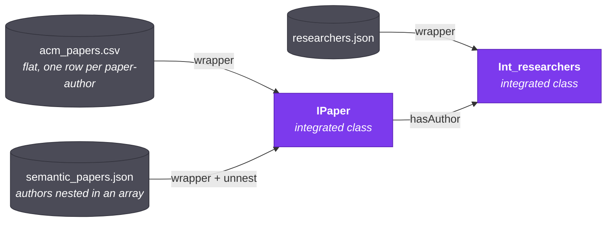

In this walkthrough, you integrate three files. Each file describes
overlapping information in a different, incompatible way. You finish by
running queries whose rows come from all three files.

It takes about 45 minutes. You do every step through the UI.

:::note Where the data comes from
The three fixtures come from the project's seminar demo, `demo/seminar/`
(its `DEMO.md` describes the scenario). Every expected result on this page
is computed from those files, so if you change a fixture, the numbers here
change with it.
:::

## What you are building

| Dataset | File | Format | Becomes |
| --- | --- | --- | --- |
| ACM Digital Library | `acm_papers.csv` | CSV, already flat | Source A → **IPaper** |
| Semantic Scholar | `semantic_papers.json` | JSON, authors nested in an array | Source B → **IPaper** |
| Researcher Profiles | `researchers.json` | JSON | **Int_researchers** |

Two integrated classes come out of it:

- **IPaper** is the union of two completely different databases. Querying it
  returns ACM rows and Semantic Scholar rows together. You name it.
- **Int_researchers** holds the researcher profiles. Aran names it, because
  nothing else describes researchers for you to align it with. It joins to
  IPaper through a **hasAuthor** relationship that matches ACM's `author_id`
  and Semantic Scholar's unnested `authors[]` against `researcher_id`.



## Before you start

- A running stack and a signed-in session — see the [Quickstart](./quickstart.md).
- The three fixture files, in `demo/seminar/` in the repository:
  `acm_papers.csv`, `semantic_papers.json`, `researchers.json`.

---

## Step 1 — Create a project

1. Open **Projects** in the left rail.
2. Click **new project**.
3. Name it `papers`, give it any description, and click **create**.

The project appears in the table. A project groups the repositories, datasets,
and integration model you are about to create.

## Step 2 — Register a repository

The files live on your machine, so the repository type is a file system.

1. Open **Repositories**.
2. Click **Register repository**, choose the `papers` project, and click
   **continue**.
3. Fill in:
   - **Name:** `uploads`
   - **Type:** File System
4. Click **Save & Register**.

There is nothing else to fill in. A file-system repository holds the files
you upload to it, and Aran reads no directory on the server for it.

## Step 3 — Upload the three datasets

Do this three times, once per file.

1. Open **Datasets** and click **Register dataset**.
2. Choose the `papers` project and click **next step**; choose the `uploads`
   repository and click **confirm**.
3. Give the dataset a name — use `acm`, `semantic`, and `researchers` — add a
   description, and select the file.
4. Click **register**.

Each dataset appears as a row with a status badge. The badge goes from
**Bootstrapping…** to **Ready** on its own, usually in a second or two.
Behind that badge, Aran has:

- snapshotted the file into the lake,
- derived a class per record type and a property per field,
- generated a first-draft wrapper for each class,
- and kicked off a best-effort profiling run.

If a badge says **Failed**, the row says why and offers **Retry**, and the
dataset's page keeps the failed job — its error code and message — until you
dismiss it. The usual causes are a JSON file whose root is neither an
object nor an array, and a JSON record with **two** arrays of plain values
(say, `authors` and `keywords`): Aran refuses that shape, because unnesting
both would pair every author with every keyword and multiply every count.
One such array per record is fine — `semantic_papers.json` has exactly one.

:::note What "Ready" means
The status badge follows the dataset's job: when the job ends, the badge says
how, even if the dataset row itself was left behind. The **Jobs** button in
the top bar lists every running, failed and recent job — imports, bootstraps,
profiling, rebuilds, materializations — from any page, so you can move on and
come back.
:::

## Step 4 — Enroll the datasets and check their wrappers

A wrapper is the SQL that turns a raw snapshot into the flat rows the
integrated class expects. Bootstrapping already wrote one per dataset, and for
these three files it is the one you want. This step puts each dataset in the
project's integration model and shows you what its wrapper does.

Click a dataset row to open its detail panel. It has five tabs: **Overview**,
**Preview**, **Profile**, **Constraints**, and **Wrapper**.

Open the **Wrapper** tab. The first time, it shows an **Enroll in model**
button, not an editor. Click it. Enrolling adds this source to the project's
integration model, and it seeds the editor with the wrapper bootstrapping
generated. Enrolling is not the same as integrating — it needs only one
source. Do this for all three datasets.

Now read each seeded wrapper. `acm`'s selects one column per CSV field.
`semantic`'s is the interesting one — its `FROM` clause ends in

```sql
FROM ${SNAPSHOT} s, UNNEST(s."authors") AS u1(_r1)
```

`UNNEST` turns each paper's `authors` array into one row per author, the
shape ACM already has, one row per paper–author pair. That is what makes the
two sources unionable at all.

Click **Validate & Preview**. The preview runs the SQL against the real
snapshot and shows up to 20 rows. For `semantic`, the first paper,
`10.1145/SS001`, has three authors and appears as three rows.

Notice the preview's column headers: each column is aliased to the full IRI
of the property it feeds, for example
`http://www.essi.upc.edu/DTIM/NextiaDI/source/<dataset id>/semantic/doi`.
That alias is the contract with the integrated views, which select those
exact column names. A wrapper that renames its columns — `doi AS paper_id`,
or a bare `SELECT paper_id, title FROM ${SNAPSHOT}` — makes every query over
the integrated class fail with a DuckDB binder error naming the missing
column. Once the class is in the active schema, Aran refuses to save such a
wrapper and names the columns it dropped; here, before Step 7, there is no
integrated class to check it against yet, so it would still save. Edit a
wrapper to change which rows it returns (a `WHERE` clause, say), and keep
each column's alias.

Aran validates wrapper SQL against an allow-list before it accepts a wrapper:
one `SELECT` over `${SNAPSHOT}`, nothing else. Aran rejects `read_csv`,
`read_json`, `read_parquet`, `http_get`, and `COPY` — reading files is the
engine's job, not the wrapper's.

## Step 5 — Align the schemas

This is where you declare what means what. Open **Alignments** and select the
`papers` project.

The view has a **left** and a **right** source selector, each with a schema
graph below it. You pick properties by **clicking nodes in the graph**, not
from a dropdown. The selected node on each side becomes one half of an
alignment. The graphs show each source's **bootstrapped** schema — its raw
field names, such as Semantic Scholar's `doi` and `authors` — not the
wrapper's output.

:::note Join discovery waits until you ask
Choosing the two sources does not run join discovery. It runs only when you
click **Auto-Infer Join Alignments**, which you do in Step 6.
:::

### 5a — Union the two paper sources into IPaper

Set the left source to `acm` and the right source to `semantic`.

For each row below, click the node on the left graph, click the node on the
right graph, choose the **kind**, type the **label**, and click
**Add Correspondence**. The mapping appears in the list underneath.

| Left (`acm`) | Right (`semantic`) | Kind | Label |
| --- | --- | --- | --- |
| the class node, `acm` | the class node, `semantic` | `class` | `IPaper` |
| `paper_id` | `doi` | `datatype` | `pid` |
| `title` | `title` | `datatype` | `title` |
| `year` | `year` | `datatype` | `year` |
| `author_id` | `authors` | `datatype` | `authorId` |

The label is what the property is called in the integrated schema. The class
alignment's label, `IPaper`, is also the name you write in OQL. **The
integrated class takes its name from the alignment label, not from any
dataset name.**

You do not align `venue` (ACM only) or `citation_count` (Semantic Scholar
only) with anything. They still appear in the integrated view. They are
simply null for rows from the source that does not have them.

### 5b — Join the papers to their researchers

Set the left source to `acm` and the right source to `researchers`, and add
one alignment:

| Left (`acm`) | Right (`researchers`) | Kind | Label | Relationship |
| --- | --- | --- | --- | --- |
| `author_id` | `researcher_id` | `join` | `authorId` | `hasAuthor` |

A `join` alignment asks for a relationship name as well as a label. The
relationship is the name you traverse in OQL as `-[hasAuthor]->`.

The label names the key property that both sides of the join share, and
reusing `authorId` — the property you created in 5a — is deliberate. The join
matches IPaper rows on whatever sits under that label, and only 5a's
alignment put Semantic Scholar's unnested authors there. With a new label,
such as `authorKey`, the model still compiles, but only ACM's rows join. Do
not reuse the relationship name as the label, either: the label and the
relationship each name a property of their own, so Aran refuses a join
labelled `hasAuthor` with relationship `hasAuthor` when you add it.

That is all `researchers` needs. No other source describes researchers, so
there is no class alignment to name them. Aran creates their integrated class
itself when the join needs one, and names it after the source class:
`Int_researchers`. It keeps the source's own property names — `full_name`,
`affiliation`, `country`, `h_index`, `email` — except for `researcher_id`, which now
appears under the join's label, `authorId`. **Check the actual class name in
the workbench catalog in Step 9 — do not assume it.**

## Step 6 — Let Aran find the join for you

Before you integrate, see what the platform would have proposed on its own.

Discovery ranks column pairs by comparing the column profiles that
bootstrapping computed in Step 3 — `acm` and `researchers` were both
profiled then, so there is nothing to run first.

Back in **Alignments**, with `acm` on the left and `researchers` on the right,
click **Auto-Infer Join Alignments**. A panel opens and discovery starts at
once. Aran scores every column pair by how much their value domains overlap.
**Run Discovery** stays disabled until the run finishes. Use it afterwards to
run again with a different method or threshold.

`author_id` ↔ `researcher_id` should rank first. Every author id in
`acm_papers.csv` is a researcher id, and no other pair of columns shares
values at all.

Ticking a candidate and clicking **Accept & Add Alignments** turns it into a
mapping. You already added this one by hand in 5b, so close the panel
instead. The point of this step: you did not need to know the join in
advance.

## Step 7 — Integrate and promote

1. Click **Rebuild draft schema (3 sources)**. This compiles every enrolled
   source into a **draft** schema version. It can take a minute.
2. When **Promote v*N* (tenant-wide)…** appears, click it. The confirmation
   lists what the draft adds, removes and changes against the active schema;
   confirm with **Promote v*N* (tenant-wide)**.

Promoting makes the draft the tenant's active schema. It also takes you to
**Schema versions**, where the new version shows as `ACTIVE`. The `int_`
views are now live and queryable.

## Step 8 — Add denial constraints

Constraints keep implausible rows out of the integrated views. They attach to
an **integrated class**, so they come after promotion — before it, a
dataset's **Constraints** tab says there are no integrated classes yet.

Open **Datasets**, click `acm`, and open its **Constraints** tab. The class
picker shows **IPaper**: a constraint added here applies to every IPaper row,
whichever source it came from. The columns you can use are listed under the
input. Add each of these. Each one lands **unenforced**, so tick its
**enforced** box:

```
year >= 1990
year <= 2030
pid IS NOT NULL
authorId IS NOT NULL
citation_count IS NULL OR citation_count >= 0
```

Write the last one null-safe. Only Semantic Scholar has citation counts, so
`citation_count` is null on every ACM row, and a comparison with null is
neither true nor false. On its own, `citation_count >= 0` would silently drop
all 40 ACM rows from IPaper — and they would not appear in the quarantine
view of rejected rows either.

Then open `researchers` → **Constraints**. The picker shows
**Int_researchers**. Add and enforce:

```
h_index >= 0
authorId IS NOT NULL
full_name IS NOT NULL
```

(`authorId` is `researcher_id` under the join's label, from 5b.)

Enforcement is live: the next query honours these rules with no recompile.
Every row in these fixtures satisfies every constraint, so the results in
Step 9 are the same with or without them.

Aran can also look for constraints in the data: **Discover constraints** on
the same tab runs discovery over the class's rows. Today it reports what it
found in a sentence and stores nothing: the engine behind it finds
dependencies between *pairs* of rows, and none of those can yet be written as
a constraint on a single row. A discovered constraint could not
be enforced in any case, and there is no button that accepts one; to act on a
finding, type the equivalent rule yourself. See
[Configure denial constraints](../how-to/configure-denial-constraints.md).

## Step 9 — Query across both databases

Open the **Query workbench** (the `/oql` route). The catalog panel lists the
integrated classes that actually exist. **Read the class names from here.**
If yours differ, use them in place of `IPaper` / `Int_researchers` below.

### Q1 — The union, visible

```
SELECT IPaper.*
```

84 rows: ACM's 40 (twenty papers, two authors each) and Semantic Scholar's 44
(one per author across its fifteen papers). `venue` is null for Semantic
Scholar rows. `citation_count` is null for ACM rows. That is the union
working, not missing data.

### Q2 — Traverse the join

```
SELECT IPaper.title, Int_researchers.full_name, Int_researchers.affiliation
FROM IPaper -[hasAuthor]-> Int_researchers
```

Again 84 rows: every author in both paper sources is in `researchers.json`,
so the join keeps every paper–author pair. A paper with several authors
produces one row per author. This is uniform across both sources, because
the `UNNEST` in the Semantic Scholar wrapper already made its shape match
ACM's.

### Q3 — Filter on the right-hand class

```
SELECT IPaper.title, IPaper.year, Int_researchers.full_name
FROM IPaper -[hasAuthor]-> Int_researchers
WHERE Int_researchers.affiliation = 'UPC'
```

Maria Garcia (R001) and Carlos Ruiz (R007) are at UPC. The query returns 11
rows over ten papers: six from ACM (ACM001, ACM002, ACM005, ACM009, ACM011,
ACM015) and four from Semantic Scholar (10.1145/SS002, 10.1145/SS004,
10.1145/SS009, 10.1145/SS011 — its `pid` is the full DOI). 10.1145/SS004
appears twice, once for each of them.

### Q4 — Filter on the left-hand class

```
SELECT IPaper.title, Int_researchers.full_name, Int_researchers.affiliation
FROM IPaper -[hasAuthor]-> Int_researchers
WHERE IPaper.year > 2023
```

15 rows: the 2024 papers ACM002, ACM009, ACM012 and ACM019 with two authors
each, 10.1145/SS011 with three, and 10.1145/SS013 with four.

### Q5 — An aggregate

```
SELECT Int_researchers.affiliation, COUNT(*) AS paper_count
FROM IPaper -[hasAuthor]-> Int_researchers
GROUP BY Int_researchers.affiliation
HAVING COUNT(*) > 5
```

Seven institutions: INESC (12), UPC (11), ETH Zurich and Oxford (8 each),
IIT Bombay (7), and CMU and MIT (6 each). `COUNT(*)` counts paper–author
rows, so a paper two UPC researchers wrote together counts twice for UPC. It
counts across both paper databases at once, which is the whole point of the
exercise.

The [OQL cookbook](../oql/cookbook.md) has more patterns, including what to
do when OQL cannot express something.

## Step 10 — Publish and connect

A query answers you; a data product answers everyone else. Save the last
one, and the same rows reach a JDBC client, an agent, or an Iceberg reader
without anyone opening the workbench.

1. With Q5's result on screen, click **◈ save as data product** under it.
2. Pick the `papers` project, name it `papers_by_institution`, keep
   **Materialized**, and click **save**. It starts `DRAFT`: nothing is
   computed yet.
3. Open **Data products**, pick `papers`, and click **⟳ refresh** on the
   `papers_by_institution` row. When the row reads `READY`, its snapshot
   exists.
4. Hand it to its readers. **⌁ agents** on the row gives the configuration an
   MCP client needs ([Connect an MCP client](../programmatic-access/mcp.md));
   a JDBC client reads it as `products.papers_by_institution`
   ([Connect a JDBC client](../programmatic-access/jdbc.md)); and the
   read-only [Iceberg catalog](../programmatic-access/iceberg.md) serves it
   to engines that speak Iceberg.

The product records the schema version it was defined against. A later
promotion marks it `STALE`, and **⟳ refresh** re-runs its query under the
version that is active then.

## What you built

- Three datasets from two formats, snapshotted, bootstrapped, and profiled.
- Generated wrappers, one of which flattens a nested array into rows.
- Two integrated classes, one of them a union of two unrelated databases.
- A join you declared, and discovery independently ranking it first.
- Denial constraints enforced on the integrated classes, across both paper
  sources.
- A data product other tools can read, over JDBC, MCP and Iceberg.

## Where to go next

- [OQL syntax reference](../oql/syntax-reference.md) — everything the language accepts.
- [The query pipeline](../deep-dives/query-pipeline.mdx) — what happened when you pressed Run.
- [The two wrapper fields](../deep-dives/wrapper-fields.md) — worth reading before you edit a wrapper outside the tab you used in Step 4.
