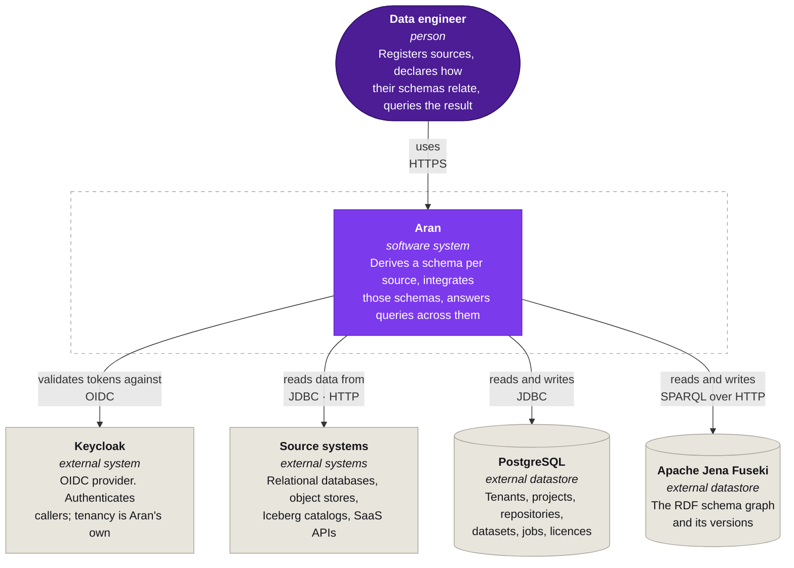
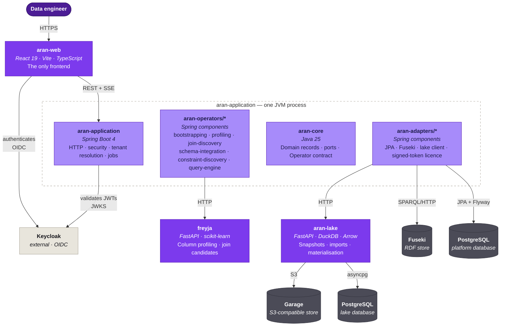
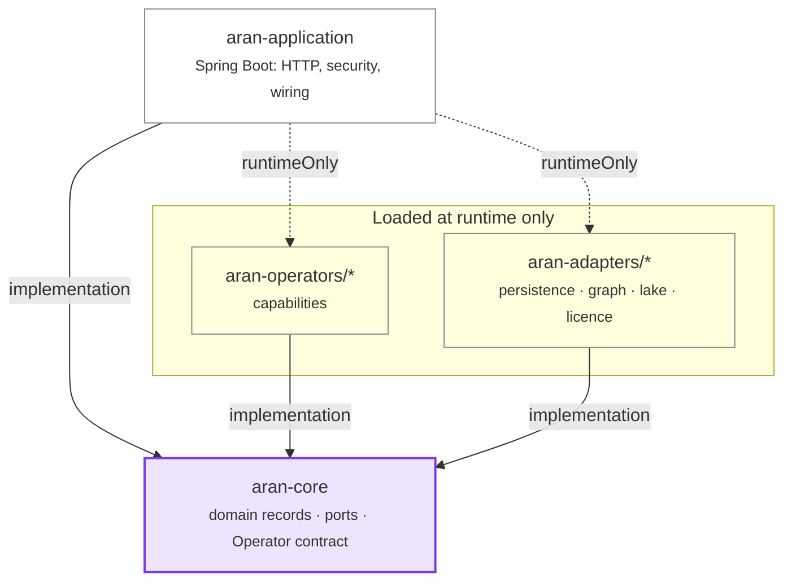
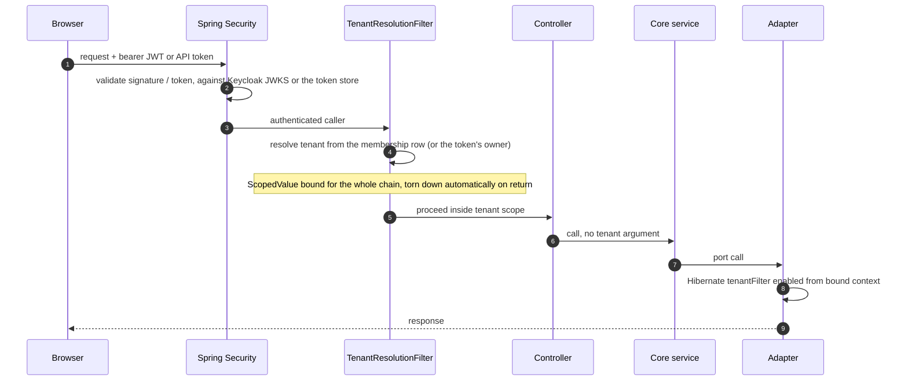

Aran is one JVM application, two Python services, a browser client and four
stores. This page describes how they divide the work and why the JVM
application itself splits into modules that cannot see each other.

## System context

Everything outside the dashed boundary is something Aran talks to but does not
own. Keycloak is the identity provider, the source systems are the customer's
databases and buckets, and the stores run alongside Aran as ordinary
off-the-shelf servers.

## Containers

Four things run: `aran-application` is the JVM process, `aran-lake` and
`freyja` are separate Python services, and `aran-web` is a browser client. The
Gradle modules shown inside the application boundary compile into that one
process. They are drawn here because the compiler enforces the boundaries
between them, and those boundaries are the most consequential structure in the
codebase. This diagram shows runtime traffic only, so the arrows between the
modules appear in [the next diagram](#the-hexagonal-boundary).

### What each one is responsible for

| Container | Port | Owns |
| --- | --- | --- |
| `aran-web` | 5173 (dev) | The entire user interface. There is no second frontend. |
| `aran-application` | 8081 | HTTP surface, authentication, tenant resolution, jobs and every operator. |
| `aran-lake` | 8085 | Snapshots, imports, materialisation and the object storage behind them. Has its own database and its own alembic migrations. |
| `freyja` | 8086 | Profiling and join discovery. Stateless. Two operators call it. |

`freyja` shares the lake's Python virtual environment on purpose, and
`make freyja-deps` installs its requirements into it.

Two more Python components ship in the repository but run on the user's side,
not in the platform: `aran-client`, the Python SDK, and `aran-mcp`, the MCP
sidecar an agent client runs beside itself. Each has its own virtual
environment, because each installs into an environment Aran does not control.

## The hexagonal boundary

The JVM application uses a ports-and-adapters design. The Gradle build enforces
the boundary by restricting what each module may depend on.

Three rules follow, and the build checks each one instead of a reviewer.

1. `aran-core` depends on nobody. It has no Spring Web and no JPA annotations,
   and domain types are plain Java records. Anything that needs the outside
   world becomes a port interface: `DatasetRepository`, `GraphStore`,
   `LakeClient`, `LicenseProvider`, `DriverDownloader`. It does use the Spring
   context for bean wiring, and it uses Jena, Calcite and DuckDB for the types
   those ports carry, but nothing ties it to a transport or a persistence
   technology.

2. Adapters and operators depend on the core, never on each other. Each
   declares exactly `implementation project(':aran-core')` and its own
   libraries, so an operator cannot call into the persistence adapter because
   it cannot see it.

3. The application depends on adapters and operators at runtime only. In
   `aran-application/build.gradle`, every operator and every adapter but one is
   `runtimeOnly`. The application compiles against the core's ports, never
   against an implementation, so a controller cannot reference a JPA entity or
   an operator's internals. The exception is the Iceberg adapter, which is a
   compile dependency because the Iceberg catalog controllers call its
   metadata generator directly. Adapters register themselves through Spring
   Boot auto-configuration, and operators register themselves through
   component scanning.

The last rule is what makes the licensing seam work. Three `LicenseProvider`
implementations exist (two in adapters, the unlimited one in the application's
configuration), each `@ConditionalOnProperty` on `aran.licensing.mode`. No
code outside them branches on deployment mode. See
[Licensing modes](../deep-dives/licensing-modes.md).

The full module table (every Gradle and Python module, what belongs in it, and
where new code goes) is in [Module layout](../contributing/module-layout.md).

## How a request flows

Every authenticated request follows the same path before it reaches anything
tenant-scoped.

The tenant is never a method parameter on the way in and never a request
header. Code that reaches tenant-scoped logic without passing through the
filter fails loudly instead of defaulting to something.
[Multi-tenancy](../deep-dives/multi-tenancy.md) covers what that buys and where
the filter does not apply.

## Where to go next

- [The query pipeline](../deep-dives/query-pipeline.mdx): OQL to DuckDB SQL, stage by stage.
- [Bootstrapping and the schema graph](../deep-dives/bootstrapping-and-the-schema-graph.mdx): how a raw file becomes RDF.
- [Module layout](../contributing/module-layout.md): the same boundaries, from a contributor's point of view.
